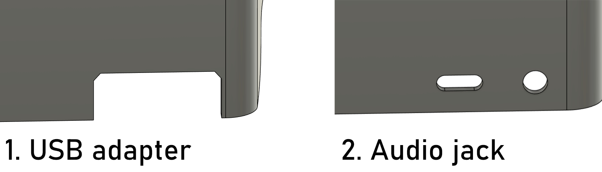
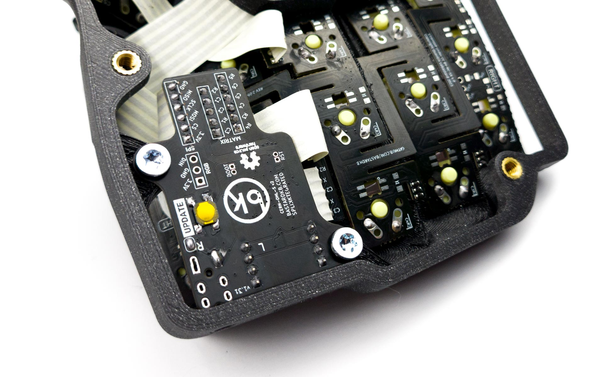
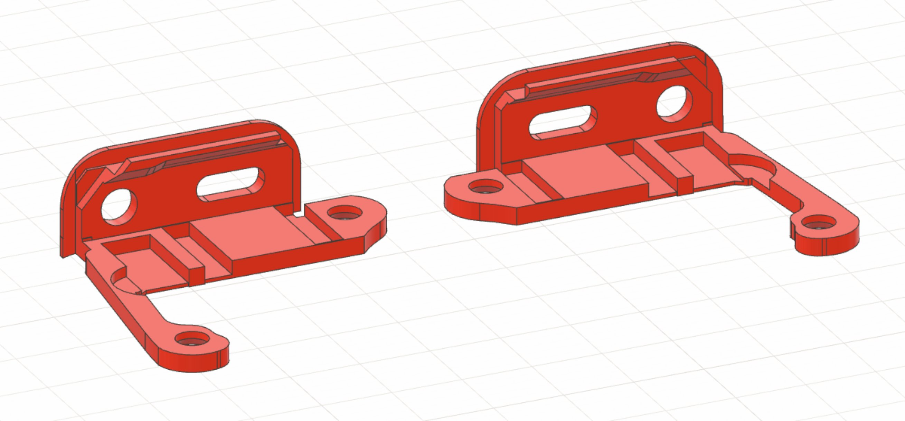
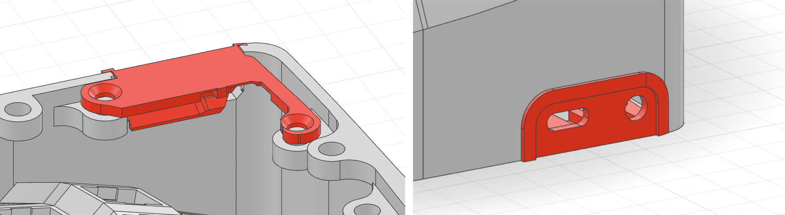

# Installing the splinktegrated

In this section we will finish installing the splinktegrated into the case.

{: .note }
The screenshots and pictures show installation on different keyboards. Installation is the same on all keyboards.

## Identifying the 3d print version

Depending on your kit version, there are two different 3d printed options.

1. "USB Adapter" version
2. "Audio jack" version

Depending on which version you got, follow the steps in either "Audio jack" or "USB Adapter" versions below.

## Installation - Audio Jack version

{: .note }
The two sides are the same, just mirrored. We will show one.

**For the following step, please prepare:**
- keyboard assembly (x2)
- M4 screw (x4)

Seat the controller in the case and fasten it with two screws. Then solder the remaining pins of the audio jack - you already tacked the 5V pin so you could align it in the case.

Do the same on the other side.

## Installation - USB Adapter version

{: .note }
The two sides are the same, just mirrored. We will show one. 

**For the following step, please prepare:**
- keyboard assembly (x2)
- M4 screw (x4)
- 3d printed adapters

- Slide the splinktegrated into the adapter
- Slide the 3d printed adapter + splinktegrated assembly onto the case
- Fasten the assembly with two screws
- Solder the remaining pins of the audio jack - you already tacked the 5V pin so you could align it in the case

Do the same on the other side.